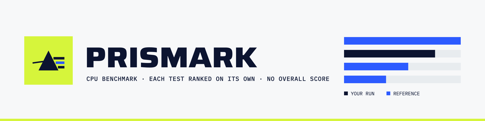
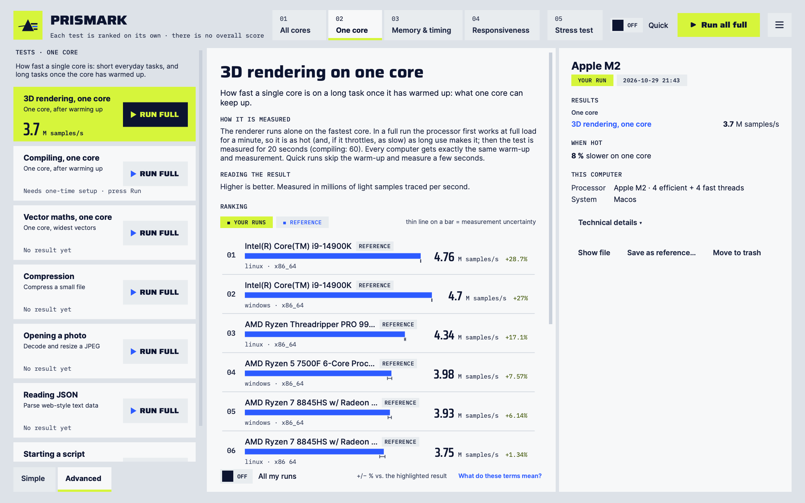

<picture>
  <source media="(prefers-color-scheme: dark)" srcset="docs/images/banner-dark.png">
  
</picture>

Prismark is a CPU benchmark for x86-64 and ARM64. It runs real work (3D rendering, compression, compiling code,
opening a photo) and ranks your processor on **each test on its own** against reference machines. It never adds the
tests up into one score: a processor that is fast at one thing and slow at another shows both.

<picture>
  <source media="(prefers-color-scheme: dark)" srcset="docs/images/app-dark.png">
  
</picture>

## Download

Get the latest release from the [Releases page](https://github.com/leonardonels/prismark/releases/latest).

| System | File | Install |
| --- | --- | --- |
| macOS, Apple silicon | `prismark-…-macos-arm64.dmg` | Open it and drag Prismark to Applications. The first start may need System Settings › Privacy & Security › Open Anyway. |
| Windows 10 or later, x86-64 | `prismark-…-windows-x86_64.zip` | Unzip anywhere and start `prismark-gui.exe`. |
| Ubuntu 22.04+, Debian 12+ | `prismark_…_amd64.deb` · `_arm64.deb` | `sudo apt install ./prismark_…_amd64.deb` |
| Fedora | `prismark-…-1.x86_64.rpm` · `.aarch64.rpm` | `sudo dnf install ./prismark-…-1.x86_64.rpm` |

Every package holds the desktop app, the command line and everything the tests need. Nothing else to install.

## What it measures

| Tab | Tests |
| --- | --- |
| **All cores** | 3D rendering, compiling code, a full software build, vector maths |
| **One core** | the same long tasks on one core, and short everyday ones: compression, opening a photo, reading JSON, starting a script |
| **Memory & timing** | memory delay with every core busy, timer punctuality |
| **Responsiveness** | how fast work starts when the processor was resting |
| **Stress test** | 10 minutes or more of full load: speed, clock and temperature over time, and a check that every result stays correct |

A full run takes about 30 minutes on a laptop; a quick run, a few. Every machine does exactly the same work, and
Prismark measures the computer as it is set up: it changes no power settings. How each test works:
[docs/measuring.md](docs/measuring.md).

## Quick start

Start **Prismark** from your applications, pick a tab and press **▶ Run** on a test, or **Run all**.

From a terminal:

```sh
prismark                          # a menu: run, past runs, compare
prismark run --quick              # a first look, a few minutes
prismark compare latest apple-m2-macos
```

On macOS the command line is `/Applications/Prismark.app/Contents/MacOS/prismark`.

## Documentation

- [Measuring](docs/measuring.md): every test and mode, the stress test, and the methodology
- [Command line](docs/command-line.md): runs, results, comparing, power readings
- [Desktop app](docs/desktop-app.md): how the app runs tests and where it keeps them
- [Building](docs/building.md): building from source on Linux and macOS, and the compile tests
- [Packaging](docs/packaging.md): how the release packages are made and checked
- [Development](docs/development.md): project status, source layout, the analyzer
- [Design](docs/design.md): colours, type and components of the app
- [Reference systems](references/README.md): the machines in the rankings, and adding your own

## Building from source

```sh
cmake --preset linux-clang
cmake --build --preset linux-clang
ctest --preset linux-clang
```

This needs Clang 19, CMake 3.25+, Ninja and, for the desktop app, Qt 6. The packages to install for Ubuntu,
Fedora and macOS are in [docs/building.md](docs/building.md).

## License

Apache License 2.0. Results produced by modified builds are marked as unverified.
